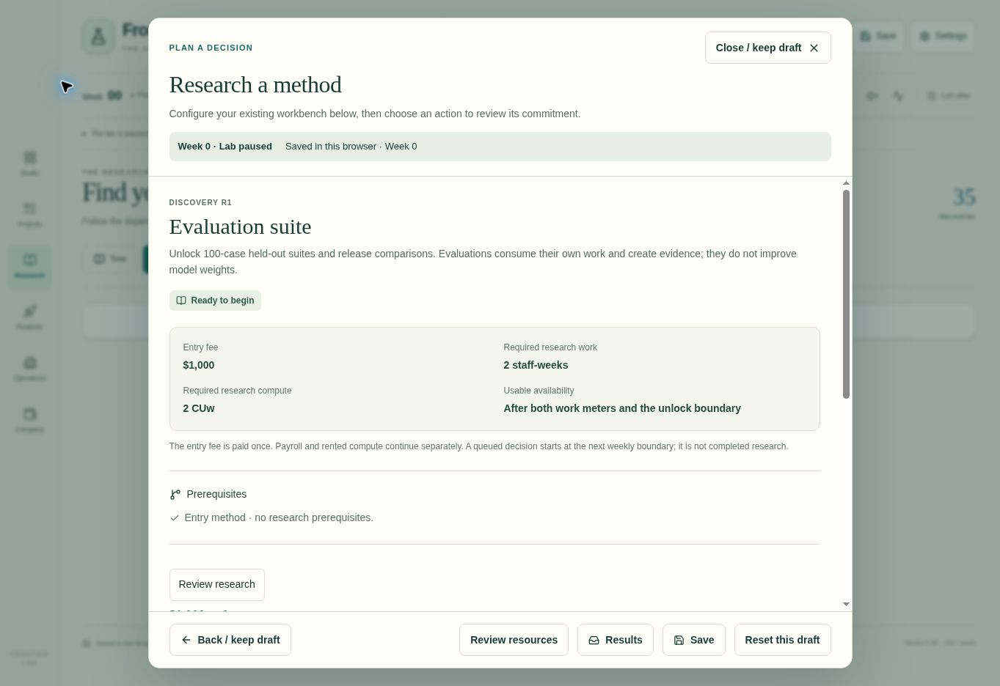
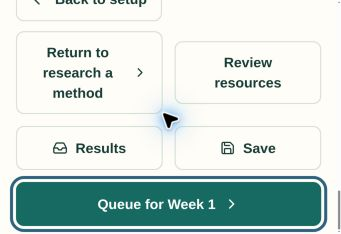

# Current copy update and Phase 30D design QA

The current **0.30.4 plain-English UI update** is documented in [its QA record](docs/PLAIN_LANGUAGE_QA.md). The Phase 30D results below describe build 0.30.3 and remain historical evidence for that menu overhaul.

## Phase 30D

**Build:** 0.30.3. **Content:** 0.28.0. **Save schema:** 5. **Status:** scoped release gates, representative mounted acceptance and exact preview restoration completed. Publication is verified separately through the native Sites deployment result.

## Scope and contracts

30D consolidates the existing game into **Studio, Projects, Research, Products, Operations and Company**, with Results, Save, clock and settings available as utilities. Narrow navigation uses Studio, Projects, Research, Products and a labelled More menu for Operations and Company. The [migration inventory](docs/WAVE30D_MIGRATION_INVENTORY.md) maps all 24 existing panel IDs, their retained owners and the complete command families, including gated late-game work.

Focused research methods preserve exact catalog identity, prerequisites, recorded work and application links. Remaining research/application, synthetic-data, product/API/business, agent, release, compute, infrastructure, Campus, chip and company choices use the shared commitment review. The review explains the selected objects, immediate and continuing costs, required work, timing and relevant gates. The existing engine still admits commands and settles their effects.

The [navigation registry](src/core/studio-navigation.ts) preserves historical panel hashes: `#research` remains the catalog, `#studio-research-tree` opens the map, `#market` remains Rivals, and `#campus` opens Campus under Operations. [Task state](src/core/studio-tasks.ts) has 21 task identities across 20 retained owners. Basic Chat launch and later management intentionally share one product form. Save replacement remains in its existing controller confirmation flow.

One shared modal host serves setup, review, acknowledgement and Results. Back and resource/research detours retain the original form; explicit reset changes that owner's draft generation. Read-only navigation preserves the clock. Entering a consequential task pauses it, and closing the task leaves it paused. No simulation formulas, unlock requirements, content version or save schema changed.

## Automated verification

**189 scoped automated checks passed: 101 core checks and 88 rendered UI checks.** The exact source parity comparison is additional evidence. The entire historical repository suite was not rerun.

| Gate | Recorded status | Scope and limit |
| --- | --- | --- |
| Focused core, task, cache and persistence suites | **101/101 passed** | Retained-task lifecycle, exact intents, acknowledgements, duplicate prevention, clock, opening journey, Results, persistence and the new navigation contracts. |
| `node scripts/check-wave30d-ui.mjs` | **88/88 passed** | Inherited workbench, menu, opening, Results and staffing checks plus research, management review and navigation. Includes the final research work-unit and infrastructure role-label regressions. Zero failures, skips or cancellations. |
| `node scripts/check-wave30d-parity.mjs` | **Passed: 37 checkpoints and nine storage comparisons** | Exact command results, full states, serialized saves and memory-backed snapshot-writer output against published 30C. This harness does not mount the browser UI. |
| `npm run typecheck` | **Passed** | Integrated application and tests; process exited successfully. |
| Supported production build | **Passed** | All five stages completed. Existing bundle-size and framework route-classification notices remain. |

[Final UI output](docs/evidence/wave30d-ui.log), [TypeScript output](docs/evidence/wave30d-typecheck.log) and [build output](docs/evidence/wave30d-build.log) preserve the final runs. The 101-check core result was observed in the runner output; no reconstructed core log is supplied.

The new [navigation tests](tests/wave30d-navigation.test.ts), [rendered navigation checks](tests/wave30d-navigation-ui.test.tsx), [method checks](tests/wave30d-research-ui.test.tsx) and [management-review checks](tests/wave30d-review-ui.test.tsx) cover exact targets, locked/missing methods, retained helper returns, product lifecycle identity, authoritative work units, stale/foreign selections, release and rollback terms, site/rack/chip tradeoffs, private appliance obligations, synthetic evidence, agent permissions and commercial deadlines. Rendered assertions do not establish mounted focus, layout or keyboard behavior.

### Exact source parity

[The recorded parity result](docs/evidence/wave30d-parity.json) compares published 30C commit **`b69fdea096175d25479f82d076a28b044f2ef6ff`**, build 0.30.2, with 0.30.3. Its opening-through-first-sale, advanced-commercial-company and staffing/resource scenarios all match. The new-company comparison normalizes only the intentional build-version header. Both engines then import identical fixture bytes; subsequent command results, states, saves and storage comparisons use those identical headers without hiding economic or state differences. All three saved-byte receipts identify the exact primary snapshot.

These are deterministic engine/storage comparisons, not three completed browser campaigns. Mounted observations are recorded separately below.

## Representative mounted browser acceptance

The [browser evidence](docs/evidence/wave30d-browser.json) records ordinary game controls, browser zoom and supported import/export. The observations below are mounted paths, separate from the engine/storage parity harness.

1. **Navigation and retained product decisions.** The desktop showed all six destinations. An existing Basic Chat price draft of **13.25** survived Back and resource review. Opening Results, following the exact **S3** research method and browsing back preserved the parent product draft and its **13.25** value.
2. **Single modal and keyboard exit.** The checked task/Results/research paths used one modal host. Escape returned through the retained flow; no second stacked decision dialog was observed in those paths.
3. **Release draft and Save detour.** A canary draft with **333** minimum cohort samples and a **3.25 CUw** candidate work budget survived a Save detour and cancelled import. During pending import confirmation, primary navigation and the retained-parent return were disabled, and no task modal overlaid the replacement review.
4. **Recorded release gates.** A stopped canary remained blocked from promotion. The UI did not treat retained canary evidence as current promotion eligibility.
5. **Accepted command versus settlement.** Double activation of the discard confirmation produced one accepted **`command-3150`**, scheduled for **Week 554**. The discard was then observed through the ordinary weekly settlement. This browser command belongs to this mounted journey; the independent parity scenario can use the same numeric command ID for a different action.
6. **Campus profile review.** The S5 profile review for **Site 1** showed **$18,000**, **three elapsed weeks**, **three Infrastructure staff-weeks**, **6 CUw** and **2 MU**. These were the selected profile's commitment terms, not a claim that the retrofit had completed.
7. **Successor identity and fabrication terms.** **Cedar Memory II** retained the exact parent **Cedar document appliance** and the memory improvement target. Its design review showed **$18,000**, **12 CUw** and **six Hardware staff-weeks**; Back retained the selection. A separate chip-batch review showed **one rack**, **eight attempted / seven useful chips**, **87.5% yield**, **six fabrication weeks** and **$11,200**, keeping fabrication and installation distinct. These checks reviewed real terms without claiming completed successor development or installed capacity.

These checks establish the listed paths and values only. They do not claim that every gated API, business, agent, hardware or site operation has been completed in the browser.

## Reflow, keyboard and restoration

At **200% browser zoom**, viewport and document widths both measured **681 CSS pixels**. At **400%**, both measured **340 CSS pixels**. Neither checked layout had horizontal page overflow. Narrow navigation exposed **Studio, Projects, Research, Products and More**; **More → Company** worked.

The final 400% footer check followed **R1 → Resources → Hire**. Its five review buttons used two **147-pixel** secondary columns and a full-width **305-pixel Queue** action after the footer overflow fix. Tab wrapped from Queue to Close, and Shift+Tab wrapped back. These were browser zoom and keyboard checks, not physical-device or screen-reader certification.

[The narrow navigation screenshot](docs/evidence/wave30d-navigation-400.png) records the corresponding five-entry layout.

The original preview lab was restored through the ordinary import/review flow and exported again. Both files are **41,831 bytes**, with SHA-256 **`2e4dd272a8fb14d5640dcac03e6a4148c606ad862b6bb4fa7e8368e62a5a4fbc`**. The final byte comparison is **equal**. Only byte counts, hashes and the comparison result are committed as evidence; snapshot contents are not copied into the repository.

## Verification boundary and publication

The scoped automated gates and listed browser paths are complete. Every gated API, business, agent, hardware and site lifecycle was not replayed to completion in the browser; broader eligibility, identity and review coverage is automated. Native publication remains tracked through the actual deployment result, separately from this source/preview acceptance record.

The [archived 30C QA](docs/WAVE30C_DESIGN_QA.md) preserves the previous release's Results/staffing journeys, zoom checks and original-snapshot restoration.
