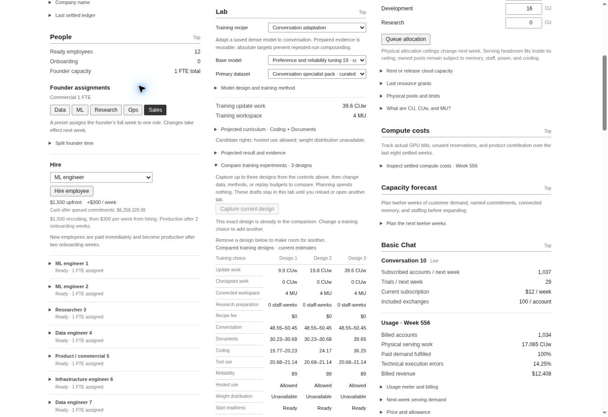
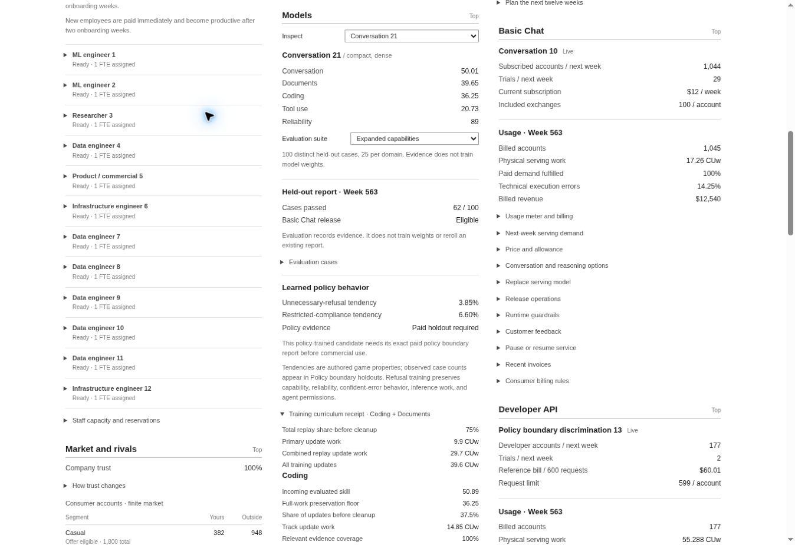

# Wave 17 — Training experiments and deeper curricula

Content/build version: **0.18.0**. Save schema: **5**.

## Delivered decisions

Wave 17 adds a small comparison bench to the existing Lab and a paid way to preserve **two evaluated skills** during ordinary adaptation. The player can compare ordinary training, existing one-skill replay, and a two-skill curriculum before committing development GPUs, staff, and cash. Native selects, buttons, compact tables, and expandable details keep the Universal Paperclips presentation.

In **Lab → Model design and training method**, use **Skill retention** to select ordinary training, **Preserve one skill**, or **Preserve two skills**. The new curriculum needs two different skills outside the adaptation's focus, separate prepared evidence for each, and a **50% or 75% total nominal replay budget**. Conversation adaptation can preserve documents and coding, for example. Coding/tools adaptation must preserve skills outside both of its focus domains.

The unlock is the existing **Replay curricula (R4C)** research after **Efficient adaptation (R4)**. It still costs **$3,000**, **6 research CUw**, and **3 research staff-weeks**. A company that has already completed R4C can use the new option without researching another program. The catalog remains at **29 authored research programs**.

## Compare up to three designs

Open **Compare training experiments**, then use **Capture current design** after selecting a base, primary corpus, method, profile, and retention choice. Up to **three drafts** can sit beside one another. Remove a draft to make room for another. The table shows update work, separate checkpoint work, connected workspace, research preparation, recipe fee, capability and reliability ranges, inherited hosted/distribution rights, and current start readiness. Expand each design for its selected sources, exact retention floors, and assumptions.

Capturing or comparing drafts performs no simulation command, advances no time, spends nothing, and draws no randomness. Estimates are recalculated against the current company when the panel is open, so a design can become blocked as resources or evidence change. **Use design** fills the training controls; the player must review the current quote and separately press **Start training**. The normal command-admission rules still apply.

These are UI-local drafts. They survive ordinary weekly updates in the open lab, but do not enter the portable save and clear on reload or opening another lab. Preview ranges are estimates rather than a paid holdout report. Physical GPU usage, rental bills, payroll, facility upkeep, teacher generation when applicable, and later evaluations retain their existing accounting boundaries. The bench does not run unattended experiments or reserve future resources.

## Sources, evidence, and rights

The incoming base must be owned and have **its own completed, paid Expanded capabilities report**. The new option applies to ordinary conversation, document, and coding/tools adaptations. It does not apply to foundations, distillation, behavior training, planner training, adapters, or deployment-format variants.

Primary adaptation data and both replay corpora must have **pairwise-disjoint underlying source IDs**. A renamed, curated, or deduplicated revision remains the same source and cannot fill a second role. Each replay track selects one to twenty distinct prepared packet IDs and must supply relevant evidence of positive quality for an existing incoming skill. Preparation or paid feedback review must already have completed. Held-out reports and policy labels do not become ordinary replay training data.

The run freezes the exact base fingerprint and paid report, each source and corpus fingerprint, coverage, quality, work allocation, cleanup savings, rights, and full-work preservation floor. Primary cleanup and each replay track receive their own earned saving; cleaning one corpus cannot discount another corpus's work. Each role pays for its own real processing.

Hosted use and weight-distribution rights follow the base lineage and **all three corpora**. Replay cannot repair a restriction inherited from a hosted-only feedback study or earlier model. The new candidates still require their own paid evaluations. A descendant with trained policy also needs its own policy report before applicable commercial admission; an Expanded capabilities report alone does not establish that qualification.

## Paid work and finite retention

The adaptation keeps its full ordinary focus-update budget. Replay adds work around it:

| Choice | Primary share before cleanup | Each replay track before cleanup | Total nominal work relative to ordinary adaptation |
| --- | ---: | ---: | ---: |
| Ordinary training | 100% | — | 1× |
| Two skills, 50% replay | 50% | 25% | 2× |
| Two skills, 75% replay | 25% | 37.5% | 4× |

The replay budget is split equally before independent cleanup savings. The actual update-work quote sums the resulting primary and both replay work requirements. This is useful model work; physical GPU work depends on the assigned hardware. Checkpoint overhead remains a separate requirement when selected.

For each skill, the full-work preservation floor is the incoming evaluated score multiplied by the **total replay share**, relevant evidence coverage, and evidence quality. Coverage saturates at **100 relevant units**. At full coverage and 95% quality, the 50% choice preserves a floor of **47.5% of the incoming skill**, while the 75% choice preserves **71.25%**. Scores use the engine's fixed-point rounding. The nominal per-track work share and this retention coefficient are distinct quantities.

Paid progress earns the floor proportionally. The completed skill is the greater of that floor and the ordinary adaptation outcome. A floor can therefore sit below the ordinary outcome and add no measured improvement for that skill, despite all replay work being paid. The comparison bench exposes that tradeoff before training. Replay adds no target headroom and cannot exceed the incoming skill by preservation alone.

The established one-skill 25%/50% option retains its earlier rules. Concentrating the replay budget on one skill can preserve that skill more strongly than splitting work across two. In the earned example below, one-skill 50% coding replay previews **48.34 coding** with **19.8 CUw**, whereas the two-skill 50% design produces **24.17 coding** with the same total work. The one-skill figure is a preview comparison, not a fourth executed candidate.

Ordinary profile draws and focus targets stay fixed across equivalent designs. Renaming packets, reordering the two tracks, repeating an equivalent curriculum, or using a descendant does not create a fresh roll or stack gains. Pause and reload preserve the admitted run and its paid progress. The existing development allocation, compatible connected memory, ML supervision, actual GPU grants, and funded weekly bills determine progress; the new mode supplies no staff, hardware, or money.

## Earned company continuation

The [natural progression receipt](evidence/wave17-progression.json) begins at **Week 553**, old-normalized checksum **`48f10a80`**, after the independently verified Wave 16 continuation described below. It reaches **Week 571** through **12 ordinary commands**, with no direct state grants.

The base is the existing compact dense **Preference and reliability tuning 19**, not a newly granted model. Its own paid Expanded report establishes **55.66 documents** and **50.89 coding**. The company allocates **128 serving CU** and **16 development CU**, keeping its existing **80 cloud CU** and owned equipment. It buys the existing Conversation specialist pack for **$6,000**, completes **two data staff-weeks** of preparation, then **three data staff-weeks** of curation. Curation has no separate upfront fee; the staff time still competes for real employees and payroll. The selected revision has **120 units**, full conversation coverage, and **95% quality**. Previously earned document and coding corpora each supply 120 units and 95% quality from separate sources.

All three executed designs use this same base, primary corpus, and stable profile. They require **4 MU** of connected workspace, have no recipe fee or research-design preparation, and run on shared development GPUs under the ordinary ML supervision rules.

| Measured result | Ordinary adaptation | Two skills, 50% replay | Two skills, 75% replay |
| --- | ---: | ---: | ---: |
| Effective update work | 9.9 CUw | 19.8 CUw | 39.6 CUw |
| Physical GPU work | 5.500000001 CUw | 11.000000002 CUw | 22.000000003 CUw |
| Recorded owned GPU variable usage | $412.49 | $824.99 | $1,649.98 |
| Cloud-work attribution within rent | $0.00 | $0.00 | $0.00 |
| Conversation result | 50.01 | 50.01 | 50.01 |
| Documents result | 30.57 | 30.57 | 39.65 |
| Coding result | 20.04 | 24.17 | 36.25 |
| Tools result | 20.73 | 20.73 | 20.73 |
| Reliability result | 89.00 | 89.00 | 89.00 |
| Training completion week | 558 | 562 | 570 |
| Fresh Expanded report week | 559 | 563 | 571 |

For the 50% design, the document floor is **26.43**, below the ordinary **30.57**, so documents stay at 30.57. Its coding floor is **24.17**, above the ordinary **20.04**, so coding improves relative to that adaptation. The 75% floors of **39.65 documents** and **36.25 coding** exceed both ordinary outcomes, but remain below the incoming 55.66 and 50.89. Retaining two skills does not preserve every capability or reliability property of the base.

Each final Expanded report consumes its own **4 development CUw and 1 research staff-week**. These costs are separate from the training-usage rows. The table also excludes existing cloud rent, payroll, data purchase and processing, fixed facility upkeep, and other company workloads. All those expenses remain in the real company ledger; cloud-work attribution, when present, is already included in reservation rent and must not be charged twice. These are measured variable training costs for this fleet, not a total project-price quote.

The deeper run is paused, saved, reloaded, and explicitly resumed. It retains the exact work already paid. Reversing its track order cannot create another attempt. All three public products stay fully served, existing batch receipts remain unchanged, and the company incurs no arrears. No new candidate replaces a live product. The campaign pays for capability reports only; it does not claim fresh policy qualification or a completed commercial release for these candidates.

The final company has **$6,593,644.39** in cash, with a measured minimum of **$6,199,383.92** during the continuation. Its **1,593,344-byte** save has checksum **`b6aaffe4`** and reloads exactly. The elapsed completion weeks include the deliberate pause and all intervening paid company operations; they are not a promise that every player's fleet completes these designs on the same schedule.

## Independent Wave 16 compatibility

Wave 16 imports change only content/build headers from **0.17.0 to 0.18.0**, retain schema 5, and do not advance time. They receive no automatic curriculum, research, source evidence, capacity, or model improvement. Existing ordinary training, one-skill replay, rights, placement history, cost receipts, and pending commands remain intact. Valid saves from all **17 prior generations, Waves 0–16**, remain supported.

The [independent compatibility record](evidence/wave17-compatibility.json) comes from the exact published Wave 16 commit **`1ab56a80d4501ba214eb778a2ab20a38a6dc5547`**, tree **`26c9f4a267c3d5814b2f77d2d290381ab63b62e4`**. All **512 original tracked files** in a separate baseline were verified against the published Git blobs. The old engine regenerated the authentic active Week 537 checkpoint byte-for-byte, checksum **`0591ee14`**, before queuing legitimate capacity, placement, and pause commands. That Week 537 fixture has checksum **`97dad50f`** and **1,457,252 bytes**.

All **16 independently captured future full-state hashes**, Weeks **538–553**, match the new engine after normalizing only version headers. The continuation exercises owned-to-cloud-to-automatic placement, capacity changes, a paid batch pause with its original deadline still running, once-only **$6,500** billing for **40,000 requests**, ordinary calibration, training pause/resume, two paid reports, rental reduction, and repeated reloads. The final old-normalized checksum is **`48f10a80`**. These expected states were generated by the preserved old production source, independently of the new curriculum implementation.

The focused compatibility suite passes **9 tests**. It also covers prior generations, checksum and future-header rejection, exact browser archives, failed storage writes, malformed curriculum fields under old headers, retained new-plan rejection, and a valid current curriculum that cannot be relabeled as Wave 16. This is focused evidence, separate from the final repository-wide release gate.

Browser upgrades archive the exact Wave 16 source bytes under **`frontier-lab.wave16.original`** before writing the upgraded primary save. An existing archive is preserved. Archive failures or primary-write failures retain a usable prior save. New curriculum selections and receipts are rejected under older headers. The **2,000,000-byte UTF-8 limit** still applies to import and compact export; lossless whitespace compaction removes no paid history or evidence.

## Implementation and scope

- `src/contracts/wave17-curriculum.ts` and `src/content/wave17-curriculum.ts` define the bounded two-track choice and authored coefficients.
- `src/modules/training-curriculum.ts` owns source validation, frozen work/evidence receipts, canonical attempt identity, and proportional retention floors. Existing planner, training, evaluation, rights, and persistence owners apply them through their normal paths.
- `src/ui/training-curriculum-controls.tsx` displays selection and retained evidence; `src/ui/training-experiments-panel.tsx` owns only local comparison drafts.
- `tests/wave17-curriculum.test.ts` covers work, independent cleanup, evidence, bounds, rights, actual resources, checkpoints, repeat admission, and forged history. `tests/wave17-progression.test.ts` reproduces the earned company continuation. `tests/wave17-compatibility.test.ts` checks independent old-engine behavior and migration.

This wave adds no new research program, new dataset catalog, new model family, automatic experiment scheduler, architecture search, real training service, autonomous deployment, or additional product channel. Existing alignment methods, policy holdouts, runtime guardrails, batch planning, chip design, and data-center operations remain their own paid systems. All AI outcomes, hardware quantities, and prices are fictional game parameters.

## Release verification records

The complete acceptance suite passes **600 tests**, with no failures or skips. Nonincremental TypeScript and whitespace checks pass. The publication workflow writes [the Wave 17 validation record](evidence/wave17-validation.json) only after the required production build succeeds, then commits and packages that exact source.

[Visible browser play testing](evidence/wave17-browser.json) starts from the earned Week 556 company. It compares all three designs, verifies that planning leaves the exported company unchanged, restores a captured design without starting it, and explicitly queues the 75% curriculum. A reload preserves that queued command while clearing temporary comparison drafts. Paid work is paused at Week 558 with 8 of 39.6 CUw complete; export, reload, and export preserve the entire save byte-for-byte. The resumed candidate finishes at Week 562 and receives its own paid Expanded capabilities report at Week 563, with the expected 50.01 conversation, 39.65 documents, and 36.25 coding scores. Its policy holdout remains a separate requirement. Existing deployments and batch receipts remain unchanged. The original Week 0 preview lab is restored and exported byte-for-byte afterward.

These gameplay checks use the managed local preview. The native Sites result verifies production publication separately; authenticated production gameplay is not inferred from a successful local check. Prior release evidence remains available in [Wave 16](WAVE16_RELEASE.md) and [Wave 15](WAVE15_RELEASE.md).

