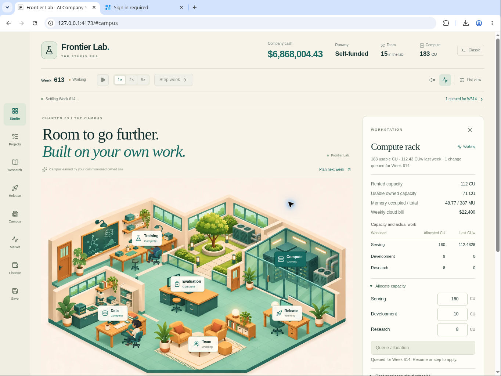
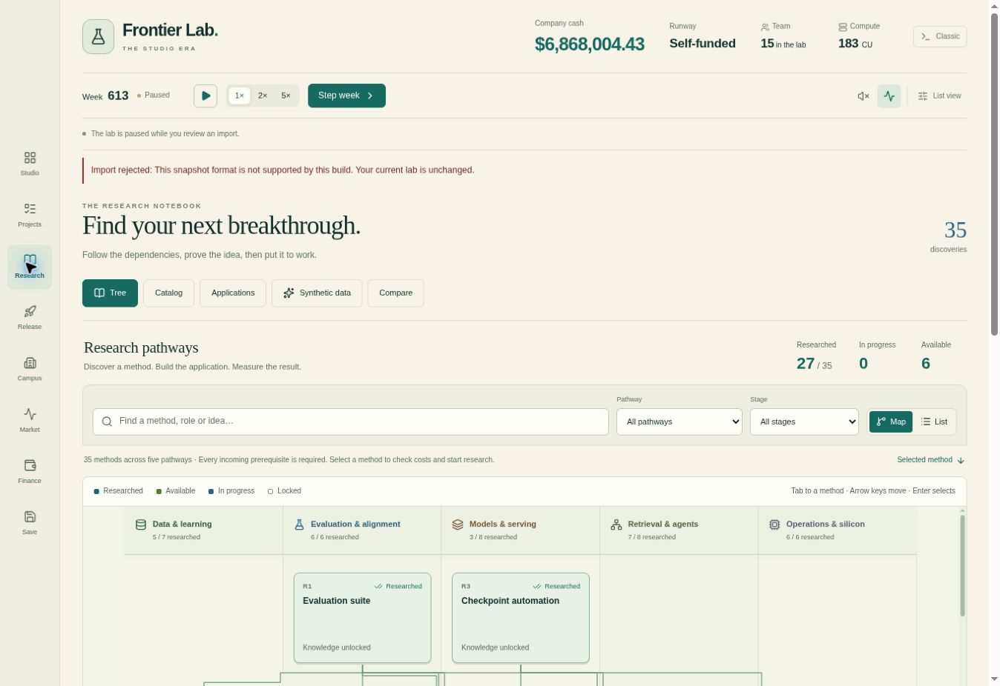

# Wave 29 design QA

**Review date:** 9 November 2026. **Build:** 0.29.0. **Content:** 0.28.0. **Save schema:** 5. This record covers source review, focused checks, production output and live preview observations. Hosted publication is verified separately by the Sites deployment result.

## Design intent

The completed Studio expansion presents a large campaign through focused workbenches. Previously, the same page also rendered hidden legacy panels and standalone planning tools, multiplying quotes and state copies on unrelated actions. Wave 29 defers that work and makes decisions, settlement and saving understandable while preserving local drafts and current state when a panel reopens. [Release notes](WAVE29_RELEASE.md) describe the behavior and implementation boundaries. [Wave 28 QA](WAVE28_DESIGN_QA.md) preserves the prior artwork, Campus, Gen 2 and high-zoom review.

## Workbench lifecycle

A context gate selects the active ordinary workbench or standalone Tree/planner. An unvisited inactive subtree is empty. A visited inactive subtree retains the last rendered React children, including their local form state, while existing CSS hides it. Returning supplies current props. The company epoch remounts those forms on import or a new lab. Classic enables each ordinary section once. The gates add no DOM wrapper, retaining `.lab-column > .lab-section` layout rules.

Cold SSR of the same Week 612 shell had previously executed 20 hidden ordinary panels plus Tree/planner, producing 103 whole-state copies. The gated initial shell executes none and produces zero such copies. The measured 3.43 s to 44.7 ms reduction is a single cold render observation, not a browser interaction benchmark. Actual mounted lifecycle behavior was checked separately in Chrome.

The live Compute form retained development 9 after a visit to People and back. Research retained a `silicon` search after leaving and returning. After the company advanced while Compute was hidden, reopening showed the current allocation9, current serving work112.4328 and an enabled queue control; the unsent form values remained a draft. Classic exposed exactly one Compute region and retained draft 10. A later final-source check retained draft 11 across a workstation switch. Importing the original company reset it to 8. See [browser observations](evidence/wave29-browser.json).

## Feedback and accessibility

The clock exposes `aria-busy` while the operation is pending; Run, Step and speed buttons are disabled. A polite atomic status outside that busy region describes the operation. Native screenshots captured **Working** and **Settling Week 614…** before completion. The completed view then reported a settled, paused Week 614 and saved status. A rapid double-click on the earlier boundary advanced exactly once from 612 to 613.

A same-week allocation showed **Saving decisions · Week 613…** before **Saved in this browser · Week 613**. The save footer has an explicit accessible name and live status. Failed saves retain the established retry/recovery interface; focused persistence tests cover rejection and quota behavior.

An invalid snapshot submitted through the real file picker produced an import error without changing the test company. Navigating to Research Tree kept that error above the workspace. The Studio alert lives outside the inspector, and only its duplicate Classic alert is hidden. The final source also pauses before opening the file picker; a live running-to-import check observed the paused notice before the file was supplied.

Action controls now bind their buttons to unique quote, blocked, incomplete or queued descriptions. SSR checks verify the target IDs exist and remain unique; the live Hire employee control exposed its description ID. No complete screen-reader or narrow-screen audit is claimed for this wave. Earlier contrast and high-zoom results remain historical evidence, not newly repeated results.

## Correctness boundaries and independent review

Command assessment reuses one checked quote per admission instead of recomputing it. Per-week read snapshots reuse only recursively frozen plain-object/array slices whose engine-owned identities have not changed. Coordinator data stays fresh on every read. Map, Set and Date fall back to independent clones, preserving the previous custom-module isolation behavior. Full input/output validation, fee checks, module order and rollback remain in place.

The exact-byte persistence cache stores validation metadata for the last observed primary string on each Storage instance. Every proposed state still validates and serializes; every changed prior string is reconsidered; every read deserializes fresh state. Cache metadata is advanced only after the successful primary write. Migration recovery archives and explicit replacement protections retain their order.

Independent read review identified and resolved three concrete issues before completion: exotic values needed fresh-copy fallback; commands/diagnostics must preserve partial-week clock progress; and the import chooser must pause before selection. Focused tests cover the first two; the final import behavior was directly observed. A final review found no further concrete high-priority issue in those corrected paths.

## Outcome compatibility

The [preserved published source comparison](evidence/wave29-core-parity.json) supplies eight command-admission comparisons and 19 continuation checkpoints spanning paid staffing plans, facility profile replacement and Gen 2 work. These checks compare full states and exact serialization, not just balances or checksums. New tests separately challenge same-tick visibility, mutable result objects, invalid input/output, malicious writes, fee mismatch and rollback.

The independent browser reference used exact published commit `6b82a6dd08e2d2ab7b78bd066a0cd043167dec38`, the already-earned Week 612 snapshot and the UI's ordinary allocation payload. Browser and reference Week 613 exports are exactly equal: **1,465,122 bytes**, checksum **bc84a4ff**, SHA-256 `5f0e28199e891dcbcf1a6a51210b793ea0f5fcc59011dc2bd7b464be241357da`. Ending cash is $6,868,004.43 and includes all ordinary company operations; it is not attributed to this allocation alone. [Reference provenance](evidence/wave29-browser-reference.json) records its independent preparation.

## Original company and verification limit

Before test imports, the original Week 556 export exactly matched the previous preserved original: **1,525,373 bytes**, SHA-256 `9db19cc7651f709865398a287e84eef9262158624bcc2efa3df2d18c11da0bf0`. It had one queued action for Week 557 and was not advanced.

After the temporary tests, ordinary import and confirmation restored that company. The UI showed savedWeek 556, paused time, the original queued action, and fresh company-specific draft defaults. A final reload was requested, then the browser URL-policy gate denied further observation. That denial was respected and no alternate browser surface was used. The restored state is supported by the pre-reload visible confirmation; exact bytes after that final reload are unverified.

## Validation and build

**149 distinct focused checks pass: 118 existing and 31 new, across ten source test files.** The [validation inventory](evidence/wave29-validation-summary.json) lists every counted identity, passing evidence, repeat exclusion and resolved initial failure. The mixed initial engine log contributes its 33 passing foundation checks; its separate stale Campus expectation is excluded and resolved by the final planning log. It keeps engine/persistence unit tests separate from SSR and native-browser evidence. Root task/clock checks pass 14/14, final TypeScript passes, and scoped controller/UI/core/persistence lint is recorded in its own logs. No repository-wide clean-lint or full-suite claim is made.

All five production-build stages pass. The Worker and hosting configuration exist, and the packaged Campus image exactly matches its source (163,428 bytes; SHA-256 `40354741c2a53269bd352247aed3ddc77667efb35a8f455cf11d37c86f2b8e44`). No new art asset or dependency is introduced. The existing large-client-chunk warning and framework route-classification/proxy notices remain. [Build evidence](evidence/wave29-build.json) links the complete log.

Simulation and persistence work still execute synchronously after a paint opportunity. The measured reductions remove repeated work; they do not establish an upper latency bound for every late-game company. Visited hidden panels also retain their mounted draft state, which trades memory for continuity.
