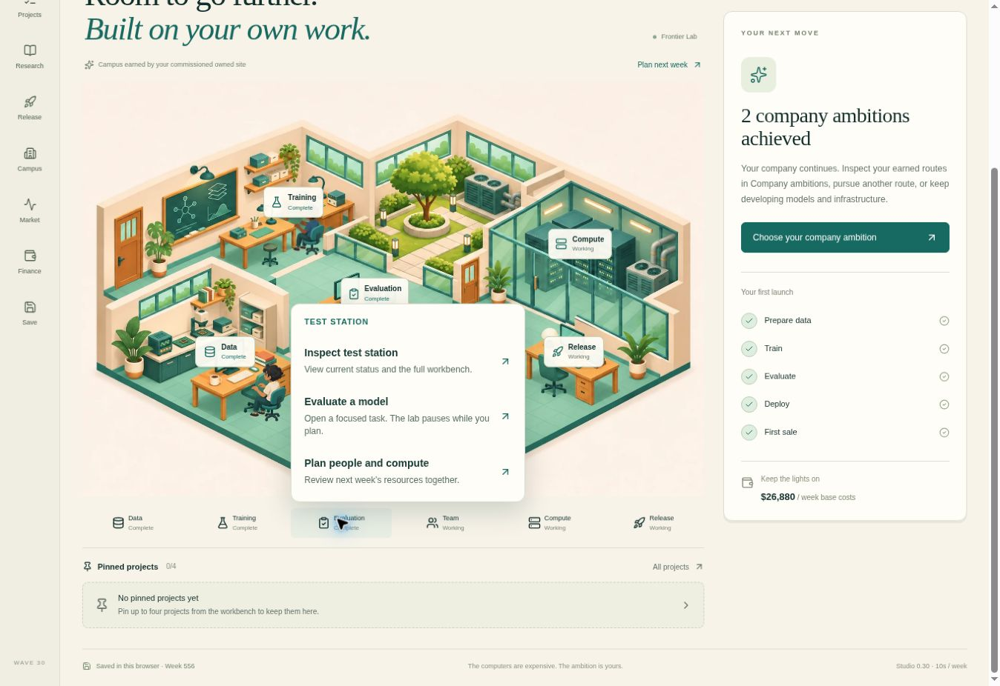
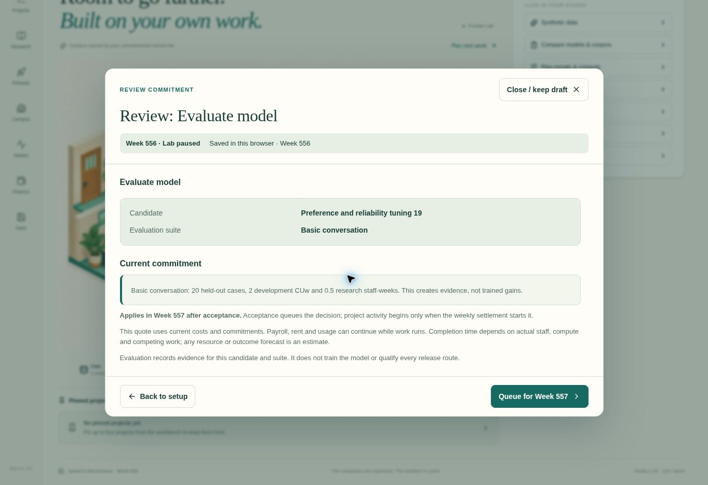

# Phase 30A design QA

**Review date:** 9 November 2026. **Build:** 0.30.0. **Content:** 0.28.0. **Save schema:** 5. Publication is verified separately by the native Sites deployment result.

## Outcome and phase boundary

30A implements the shared task foundation from the UI Overhaul Plan: workstation action menus, one retained dialog/sheet, commitment review with real acknowledgement, bounded task metadata, exact candidate/report navigation, resource detours, explicit draft reset and project/result primitives. [Release notes](WAVE30A_RELEASE.md) state the implementation contracts and remaining phases. [Wave 29 QA](WAVE29_DESIGN_QA.md) preserves the prior performance and persistence work.

The full guided opening journey, persistent Results inbox, staffing menu migration and navigation consolidation remain 30B–30D. Existing advanced workbench entry points are retained.

## Focused validation

**56 distinct focused checks pass.** These are not a full repository test run.

| Suite | Result | Coverage |
| --- | --- | --- |
| `node scripts/check-wave30-ui.mjs` | 22/22 | 14 new SSR checks plus eight existing Wave 29 workbench checks; named surfaces, quotes, one host, exact entity consumers, lazy rendering and observer states. |
| `node scripts/test-wave0.mjs wave30-task-state wave30-submission wave29-browser-task clock` | 34/34 | 16 task state/intent checks, four deferred cancellation checks and 14 existing clock/gate checks. |
| `npm run typecheck` | Pass | Final integrated source. |
| Production build | Pass | All five build stages. Existing large client chunk and framework route-classification notices remain. |
| CSS validation | Pass | PostCSS parse and Lightning CSS validation/minification; no warnings. |
| `git diff --check` | Pass | Final source whitespace check. |

[SSR output](evidence/wave30-ui-final.log), [TypeScript output](evidence/wave30-typecheck-final.log) and [build output](evidence/wave30-build.log) preserve the corresponding runs. Scoped test/runner lint passed; no full-repository lint claim is made.

The real opening and advanced cold shells execute zero unvisited ordinary workbench bodies and make zero whole-state preview copies. These checks establish retained lazy behavior, not a new browser latency benchmark.

## Mounted browser acceptance

Testing used the supported managed Chrome preview. The [browser observation record](evidence/wave30-browser.json) separates observed results from untested cases.

- A workstation menu opened with the keyboard. Arrows and Return closed it before focus moved to the task heading.
- The task exposed exactly one named `aria-modal` dialog. Nine surrounding branches were inert. Shift+Tab from the heading moved to the last control; Tab wrapped to Close.
- Prepare data showed the existing $1,000 quote and Week 1 timing before submission. Actual controller acceptance produced the queued receipt. Projects then showed one pending change, $1,000 reserved and the unchanged $48,000 balance before weekly settlement.
- A Document adaptation draft survived Close, reopening, a planner detour, Return to task and Escape. Explicit Reset restored Conversation adaptation. Close returned focus to the named opener and left the clock paused.
- Invalid JSON import displayed a rejection while keeping the existing company and Resume task action. Accepted original import cleared task drafts together with the company epoch.
- An older completed training result selected Preference and reliability tuning 19 (`model-wave15-natural-command-9`) while the newest of 43 candidates was Targeted synthetic curriculum 20.
- Classic rendered one model selector and one training selector, with no modal. The same company returned to Studio afterward.

## Reflow and accessibility limits

At the observed desktop viewport of 1363 × 936 CSS pixels, the dialog centered over the existing scene. Ordinary browser zoom produced widths of 779 pixels at 175%, 681 pixels at 200% and 340 pixels at 400%, with no document horizontal overflow. At 400%, the narrow sheet used its short-viewport outer scroll; Tab brought Training recipe fully into view at y=96.96–140.96 within the 234-pixel-high viewport. Browser zoom was restored to 100% afterward.

Organization policy disabled DevTools, so exact device emulation was not used. No policy setting was changed. A physical mobile keyboard and a screen-reader session were not tested. Observer, missing-target, stale async result and cancellation paths have source/SSR coverage; not every case was separately induced in Chrome. Classic still has the existing cost of rendering the full advanced company; this phase does not promise a latency ceiling for it.

## Compatibility and original-save restoration

The [deterministic comparison](evidence/wave30-parity.json) compares baseline commit `4694353853fff04c1fa9587faf49f12c2bdea661` against 30A using identical imported bytes. **All 27 full-state and serialized-byte checkpoints match**, covering the opening through first sale and an advanced company through two weekly settlements. **Four browser snapshot writer comparisons also match** using memory-backed Storage objects. Rejections, paid actions, exact training output, evaluation and Basic Chat launch are included. The replay harness is `scripts/check-wave30-parity.mjs`; run it from the repository root.

This source comparison does not substitute for the separate mounted tests. In Chrome, the original Week 556 company was exported before temporary tests and restored through the ordinary import review. The final export was exactly equal: **1,525,373 bytes**, SHA-256 `9db19cc7651f709865398a287e84eef9262158624bcc2efa3df2d18c11da0bf0`. It remained paused with its original one queued action for Week 557. [Restoration evidence](evidence/wave30-restoration.json) records the byte comparison.

## Defects found and fixed before release

A closed review could previously retain payload A while its inline form was later edited to B. Close now returns reviews to editing and clears their captured payload while preserving the form owner and inputs. A regression check confirms that reopening at the same game revision still has no submission context until another review is made. Accepted receipts remain separately retained.

The build metadata update initially left the content validator constrained to Wave 29. The validator now accepts the complete Wave 0–30 roadmap and requires Wave 30 as current. Final SSR, TypeScript and production build passed after that repair.

A historical accepted receipt now checks its command ID against the current queue before claiming the work has not started. Once its queue entry is gone, it states that it is an original acceptance receipt and directs the player to current Projects.
