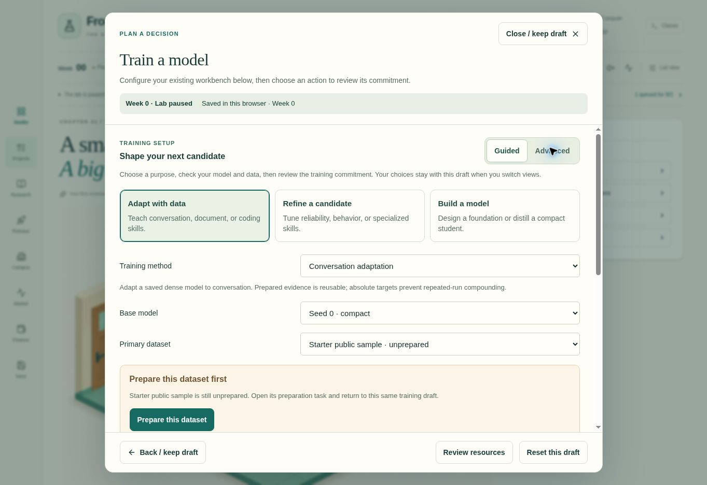
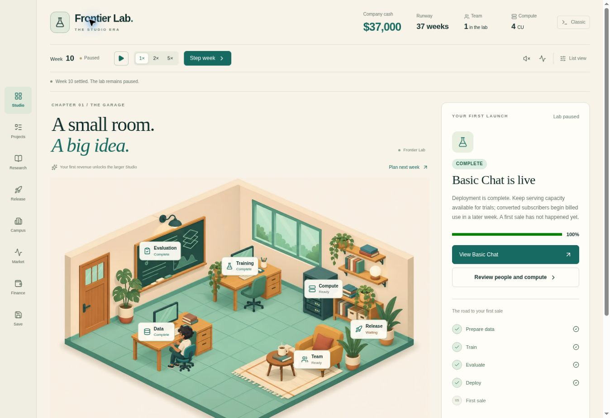

# Phase 30B design QA

**Build:** 0.30.1. **Content:** 0.28.0. **Save schema:** 5. Publication is verified separately through the native Sites deployment result.

## Outcome and phase boundary

30B connects the complete opening journey: selected data → Guided/Advanced training → actual queued and active work → exact output candidate → exact capability report → first Basic Chat launch. The five opening milestones stay visible, with deployment separate from the first sale. [Release notes](WAVE30B_RELEASE.md) describe the design and implementation contracts. [30A QA](WAVE30A_DESIGN_QA.md) preserves the earlier shared-menu evidence.

The persistent Results inbox, staffing-menu migration and navigation consolidation remain 30C–30D. No simulation rules, save schema or advanced release prerequisites were added.

## Focused automated validation

**96 distinct focused checks passed.** This is a scoped release gate, not a claim that the entire historical repository test suite was rerun.

| Gate | Result | Scope |
| --- | --- | --- |
| `node scripts/check-wave30b-ui.mjs` | 40/40 | Retained and lazy workbenches, shared surfaces, single Guided/Advanced controls, exact dataset/report/candidate consumers, unrelated evidence and existing-product handling. |
| `node scripts/test-wave0.mjs wave30-task-state wave30-submission wave29-browser-task clock wave30b-task-state wave30b-journey` | 56/56 | Task lifecycle, real acknowledgements, cancellation, duplicate prevention, exact intent ownership, bounded helper return, actual opening progression, rejection and deterministic continuation. |
| `npm run typecheck` | Pass | Integrated application and tests. |
| Supported production build | Pass | All build stages. The existing bundle-size and framework route-classification notices remain. |
| `node scripts/check-wave30b-parity.mjs` | Pass | Exact published 30A baseline, two fixtures, 27 complete-state/result/serialized-byte comparisons and four snapshot-writer comparisons. |

[UI output](evidence/wave30b-ui.log), [core output](evidence/wave30b-core.log), [TypeScript output](evidence/wave30b-typecheck.log), [build output](evidence/wave30b-build.log) and [parity evidence](evidence/wave30b-parity.json) preserve the corresponding results. The cold shell still executes no unvisited ordinary workbench bodies and clones no whole GameState for the opening guide.

## Mounted opening acceptance

The [browser evidence](evidence/wave30b-browser.json) records an ordinary run in managed Chrome, starting from the preview's backed-up Week 0 company. No direct state grants or runtime state edits were used.

1. Guided → Advanced → Guided retained the selected Stable training profile. Training → selected Data → resources → Return to training retained both the profile and `starter-public` dataset.
2. Preparation produced one real accepted command for Week 1. The guide showed actual 50% preparation progress after settlement, then ready data in Week 2.
3. Training showed the recorded ML supervision blocker in Week 3. A reviewed resource plan assigned the founder and development compute; the guide then showed 4 / 13.2 CUw in Week 4. Training completed in Week 7.
4. **Evaluate this candidate** selected `model-command-9`, the exact output of `training-command-9`. A resource detour kept that candidate. Its paid Basic conversation report completed in Week 8.
5. **View this report → Review Basic Chat launch** selected the same candidate and its exact report. The player edited the price to $12.50 and allowance to 125. Both values and the candidate survived a resource detour, Escape and Resume.
6. The launch review displayed those terms, the exact capability report, one ML staff-week, resident memory and Week 9 timing. A double-click on confirmation produced one deployment command, `command-41`; the queue contained that deployment and the separate resource plan.
7. Deployment became ready in Week 9 and explicitly named Week 10 activation. Week 10 showed **Basic Chat is live**, while **First sale** remained incomplete and earned revenue remained zero.
8. Importing the original snapshot through the ordinary review reset all local task and journey identities. Its final export exactly matched the original bytes, and the lab remained paused at Week 0.

## Reflow and keyboard acceptance

The launch menu exposed one dialog. At 200% browser zoom, the viewport measured 681 × 468 CSS pixels and the dialog measured 649.5 × 436. At 400%, the compact sheet measured 340.75 × 234 within a 340 × 234 viewport, with its outer scroll providing access to the complete form. The subpixel width difference is below one CSS pixel. Price, allowance and review remained usable. Shift+Tab from Close wrapped to Reset within the dialog. Escape returned focus to the launch opener and retained the draft. Zoom was restored to 100%.

[Narrow launch evidence](images/wave30b-launch-narrow.png) and [compact sheet evidence](images/wave30b-launch-compact.png) show those checks. These were browser zoom checks, not device emulation. A physical mobile keyboard and screen-reader session were not tested. Older-of-two candidates, unavailable and foreign targets, weekly rejection and deferred cancellation have automated coverage; not every case was separately induced in Chrome.

## Compatibility and restoration

The exact source baseline is `a6208e73dfe0619350dab0571846c80bf545593b` (published 30A). New-company equality normalizes only the intentional buildVersion header. Imported fixtures retain identical original headers for every later comparison; no economic, random, queue or saved-state difference is normalized away.

The original preview snapshot and restored export are both **41,831 bytes**, SHA-256 **`1812bbc2fffd6f23b6f147b1548e46991ee2d4dbc4be808e0075760af15f79f4`**. The imported opening keeps its original 0.30.0 snapshot build header while the UI under test is 0.30.1. The original paused company is restored, with no queued decisions introduced by testing.

## Defects corrected during this phase

- The Models workbench could label a displayed diagnostic report eligible because a different report passed. Eligibility and the launch handoff now refer to the displayed exact report and the actual current Basic Chat model checks.
- Returning directly from a child review could leave its old captured payload ready for later reuse after inline edits. Return now retires that review while preserving both forms.
- An unavailable journey initially offered a candidate-choice action without a visible choice. It now supplies named owned candidates or a usable explicit recovery action.
- The selected purpose heading inherited white text on a pale background. It now keeps dark text with a visible selection border.
