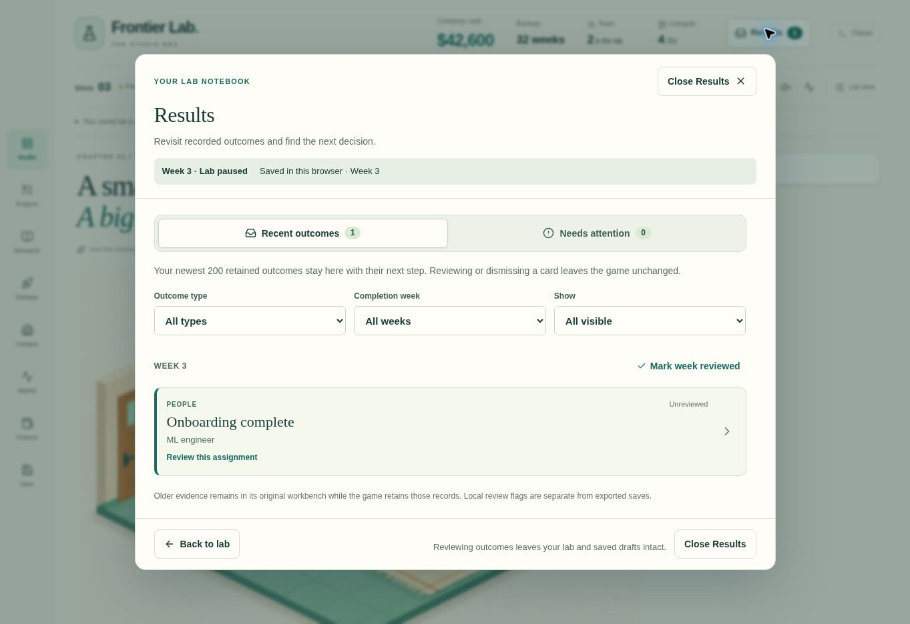
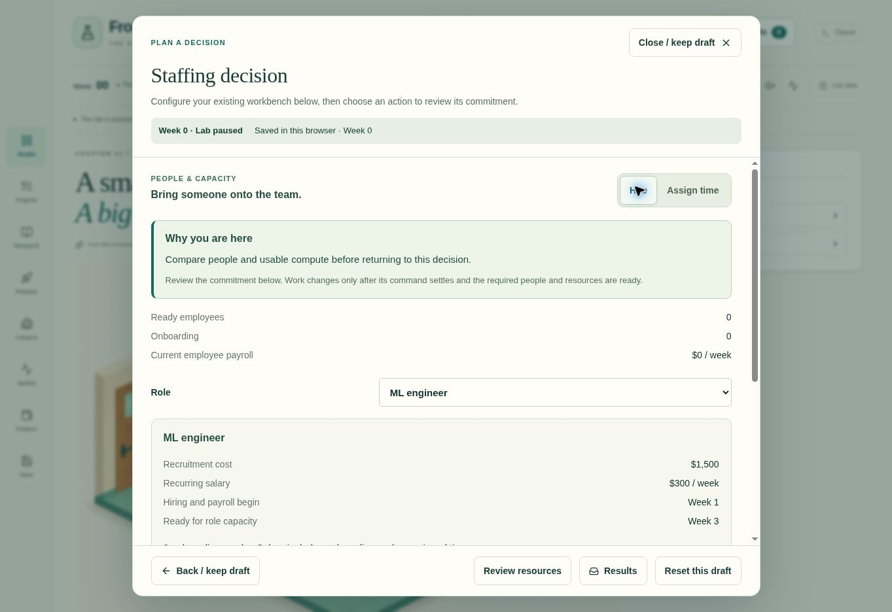

# Phase 30C design QA

**Build:** 0.30.2. **Content:** 0.28.0. **Save schema:** 5. Publication is verified separately through the native Sites deployment result.

## Outcome and phase boundary

30C adds the global Results inbox, focused Hire and Assign time menus, and contextual resource review from the UI Overhaul Plan. Results distinguishes recorded outcomes from current constraints and follows the exact retained source. Staffing explains recruitment, payroll, readiness and intended capacity before a real command is queued. Resource detours keep the originating draft and a named return route.

[Release notes](WAVE30C_RELEASE.md) explain the implementation contracts. [30B design QA](WAVE30B_DESIGN_QA.md) preserves the opening-journey acceptance record. The remaining menu families and navigation consolidation belong to 30D.

## Focused automated validation

**149 distinct checks passed.** This is a scoped release gate; the entire historical repository suite was not rerun.

| Gate | Result | Scope |
| --- | --- | --- |
| `node scripts/check-wave30c-ui.mjs` | 58/58 | Previous shared menus and opening journey, six Results checks, twelve focused staffing/planner checks. |
| Core/cache test run | 75/75 | Task lifecycle, real acknowledgements, duplicate prevention, clock, opening progression, twelve Results selector checks and existing browser snapshot cache behavior. |
| `node scripts/test-wave0.mjs wave30c-results-persistence` | 16/16 | Exact-byte binding, quiet reload/import, stale/foreign/corrupt metadata, bounded retention, ownership, write failure and delayed callback races. |
| `npm run typecheck` | Pass | Integrated application and tests. |
| Supported production build | Pass | All five stages. Existing bundle-size and framework route-classification notices remain. |
| `node scripts/check-wave30c-parity.mjs` | Pass | Exact published 30B baseline; three scenarios, 37 complete-state/result/serialized-save checkpoints and nine exact snapshot-writer comparisons. |

The core/cache command was `node scripts/test-wave0.mjs wave30-task-state wave30-submission wave29-browser-task clock wave30b-task-state wave30b-journey wave30c-results wave29-persistence-cache`.

[UI output](evidence/wave30c-ui.log), [core/cache output](evidence/wave30c-core.log), [persistence output](evidence/wave30c-persistence.log), [TypeScript output](evidence/wave30c-typecheck.log), [build output](evidence/wave30c-build.log) and [parity evidence](evidence/wave30c-parity.json) preserve the results.

## Mounted Results and staffing acceptance

The [browser evidence](evidence/wave30c-browser.json) records ordinary UI interaction in managed Chrome. The preview's original Week 0 save was exported before testing. Simulated hires, assignments and weekly steps used normal game controls; no runtime state edits or fabricated grants were used. The existing advanced fixture was loaded through the normal import review for historical navigation.

1. Results opened from Save as one dialog, with an empty initial history and separate current-attention section. Opening it did not queue work or advance the paused lab.
2. The Hire menu showed an ML engineer's **$1,500 recruitment, $300/week salary, Week 1 hiring/payroll and Week 3 readiness**. It truthfully described the existing one-FTE starting assignment and zero productive capacity during onboarding.
3. Changing the hire role to Data engineer, opening Results and returning retained the role. A resource detour retained the staffing form. Choosing Hire from that detour returned directly to staffing without creating a self-return loop; one Close dismissed the dialog.
4. Founder drafts of **0.25 Data / 0.75 ML** survived Hire/Assign switching and remained unsent. The later founder view still showed current **1 Data / 0 ML**, distinguishing the draft from committed capacity.
5. A double-click on the hiring confirmation produced **one accepted command, `command-2`**. Week 1 showed one onboarding employee, $300/week payroll and no ready employee capacity. The exact employee was `staff:command-2`, hired Week 1 and ready Week 3.
6. After stepping to Week 3, the global Results count became **one unreviewed**, with no forced dialog. Reload restored the same unread count, paused Week 3 and the ordinary saved-lab message. Opening the onboarding detail marked it reviewed and displayed its actual readiness, assignment and salary.
7. Dismissal survived reload: the default list hid the result and **Show → Dismissed** exposed it. Exporting and reimporting the identical Week 3 snapshot created a fresh UI timeline: that historical outcome appeared **Reviewed**, visible and not dismissed, with zero unread results.
8. **Review this assignment** selected `staff:command-2`. A proposed **0.5 FTE** survived the planner detour. Its review showed **1 → 0.5**, continuing salary and Week 4 timing. Normal submission produced `command-9`; the Week 4 exported employee had `assignedFte: 500000000`, the game's fixed-point representation of 0.5 FTE.
9. The imported advanced company remained paused at Week 553 with zero unread historical outcomes. Filtering Training to Week 508 and following **Evaluate this candidate** selected **Document adaptation 17**, `model-wave15-natural-command-2`, although newer candidates existed. It did not silently choose the latest model.
10. The advanced lab's current **Basic Chat canary** attention item opened the planner with that exact title and recorded reason. **Return to evaluation** preserved the selected model task.
11. Importing the original snapshot reset task identity. A final export matched the backup byte for byte and the lab remained paused at Week 0 with no testing commands queued.

## Reflow and keyboard acceptance

At **200% browser zoom**, the viewport measured **681 × 468 CSS pixels** and the page had no horizontal overflow. Results retained its three filters and scrolling content. At **400%**, the viewport measured **340 × 234**, the compact dialog was 340.75 CSS pixels wide and its outer scroll held the full result history. The subpixel width difference is below one CSS pixel.

At 400%, Shift+Tab from Close Results wrapped to the final **Back to evaluate a model** action inside the same dialog. Its measured focus rectangle was within the viewport. Escape returned to the retained evaluation task and focused its heading. In focused staffing, keyboard navigation reached **Review hire**, with its complete 44-pixel-high control in view and no horizontal page overflow. Zoom was restored to 100%.

[Results at 200%](images/wave30c-results-200-percent.png), [Results at 400%](images/wave30c-results-400-percent.png) and [staffing at 400%](images/wave30c-staffing-400-percent.png) record those layouts. These were browser zoom checks, not physical mobile or screen-reader sessions. Completion sounds were disabled, so no audible playback claim is made. Observer ownership, unavailable/foreign targets, storage failures and delayed hashes have automated coverage; these failure cases were not all separately induced in Chrome.

## Compatibility and restoration

The exact source baseline is **`94795f80b62a7b05ab1dd0b012e3ca2a49b86b71`**, published 30B. The opening-through-first-sale, advanced-company and staffing/resource scenarios match at every comparison. The initial new-company comparison normalizes only the intentional buildVersion header; economic, random, command and saved-state differences are not normalized away. No simulation rules or schema changed.

The original preview snapshot and restored export are both **41,831 bytes**, SHA-256 **`3d25570b6af78b8e7014e3e727096278d5a3a9704440a2d7900bd7c47d81ab27`**. Original/exported game snapshots are not committed as browser evidence; the structured record retains their hashes and the relevant command/employee proof.

Results flags are local presentation metadata, separate from exported game saves. Their 64-KiB, 200-key envelope uses a random timeline token, player ID and SHA-256 binding to exact successfully saved bytes. Matching reloads restore flags quietly; accepted replacement starts a new timeline. Only the controlling owner writes shared marks. The game save takes priority over UI metadata: sidecar failure can lose or localize flags without blocking the primary save. If every durable invalidation attempt fails during an identical-byte replacement, a subsequent crash can prevent durable proof of that replacement; the primary game remains intact. This is a UI-attention limitation, not a game-state transaction.

## Defects corrected during this phase

- Returning to staffing through its own resource detour could retain a stale parent and show a repeated **Return to staffing** loop. The direct return now retires that detour before reopening the retained staffing form.
- Reopening the planner while already reviewing resources could overwrite the original return target. Repeated review now preserves that target.
- Accepted replacements now invalidate old Results marks even if a new token cannot be generated, and retained touched-key bookkeeping is pruned with the bounded result window.
