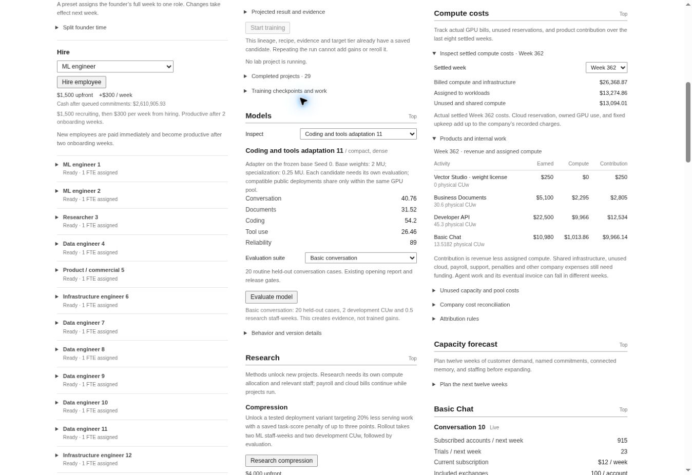

# Wave 8 release handoff

**Frontier Lab — Physical scale and operating costs**

Content/build **0.9.0**; save schema **5**. This wave adds independent facility power and cooling extensions, paid relocation of existing racks, and a settled operating-cost meter. Each connects to the existing hiring, construction, hardware, workload-placement, product and company-accounting systems.

**Verified:** the full acceptance suite passes **351/351 tests with zero failures and zero skips**, `npm run typecheck` exits 0, and the official Sites `build-site.mjs` production build exits 0. The ordinary progression receipt has been regenerated after the retention correction. Browser verification covers paid extensions, relocation, settled costs, historical reports, exact save/reload and restoration of the original preview company.

The interface keeps the Universal Paperclips style: ordinary buttons, compact metrics and tables, and expandable details within the existing page. All **28 authored research programs remain implemented**. Wave 8 adds applications of Enterprise operations and Capacity forecast; discovery remains distinct from paying for and operating an application.

## Unlocks and authored costs

CU is capacity, CUw is work performed over a week, and MU is resident memory. Physical rack space is counted separately from usable capacity. A standard facility holds **64 CU of rack space**, equivalent to **eight 8-CU rack footprints**; production yield can reduce useful CU without reducing the purchased footprint.

| Discovery | Prerequisites | Fee | Staff effort | Research work | Wave 8 applications |
| --- | --- | ---: | --- | ---: | --- |
| **R12 — Enterprise operations** | R3 and R10 | **$8,000** | **6 infrastructure staff-weeks** | **12 CUw** | Facility extensions and installed-rack relocation |
| **R12A — Capacity forecast** | R12 | **$1,000** | **2 infrastructure staff-weeks** | **2 CUw** | A separate operating cost meter, alongside the established forecast |

These are the existing discoveries and their authored requirements. A company that has already completed one keeps that knowledge. Ordinary payroll and compute charges apply while research and implementation proceed. Research becomes available at its normal boundary before dependent work is admitted.

| Application | Capital payment | Independent work requirements | Effect after commissioning | Continuing requirement |
| --- | ---: | --- | --- | --- |
| **Power feed extension** | **$18,000** | **4 elapsed weeks** and **2 infrastructure staff-weeks** | Site power limit **64 → 112 units** | **$60/week**, **0.05 infrastructure FTE** |
| **Cooling loop expansion** | **$14,000** | **3 elapsed weeks** and **1.5 infrastructure staff-weeks** | Site cooling limit **64 → 112 units** | **$40/week**, **0.05 infrastructure FTE** |
| **Relocate one installed rack** | **$1,500** | Three sequential stages: **4 elapsed weeks minimum** and **1 infrastructure staff-week** in total | The same paid rack operates at its destination | Destination upkeep and staffing replace source rack requirements at commissioning |
| **Operating cost meter** | **$0 upfront fee** | **1 ML staff-week** and **1 development CUw** | Records subsequent settled cost reports | Ordinary implementation wages and compute; no additional reporting tariff |

Source coefficients are in [the research catalog](../src/content/catalog.ts), [retrofit definitions](../src/content/wave8-retrofits.ts), [relocation definitions](../src/content/wave8-relocation.ts), [system rollout requirements](../src/content/wave4-research.ts), and [the accounting policy](../src/content/wave8-costs.ts).

## 1. Independent facility extensions

In **Infrastructure**, open an operational owned facility and choose its power or cooling project. Each extension is available once per site. The two projects can coexist and compete for available infrastructure staff after operating coverage. Both their elapsed-time and staff-effort meters must finish. Pausing retains the payment and completed work while stopping both meters. Unpaid company bills suspend progress. The extension becomes active at the following weekly boundary.

Construction preserves the site's existing capacity. Only an active extension changes its envelope, upkeep and operating-staff requirement. A ready project still shows the old limit until commissioning. Sites that have neither extension keep their prior economics.

Power and cooling constrain the same installed hardware independently. For example, eight standard training racks demand **102.4 power units and 102.4 cooling units**. With sufficient staff, the original 64-unit envelopes limit that site to **40 usable CU and 80 MU**. Expanding power alone leaves cooling as the bottleneck; expanding cooling alone leaves power as the bottleneck. With both active, the already purchased racks supply **64 usable CU and 128 MU**.

The eight physical rack footprints remain full throughout. The extensions preserve hardware identity, qualified yield, memory per CU, execution efficiency and variable tariffs. A job must still fit one compatible connected pool. Staffing remains an independent limit, and sparse work still requires fast fabric at its actual location.

For those eight training racks, the ordinary site-and-rack fixed bill rises from **$560 to $660 per week**, and operating coverage rises from **1.25 to 1.35 infrastructure FTE**. Parking releases active power and cooling demand while retaining installed upkeep and coverage requirements. The chip payback forecast includes a selected owned site's active extension upkeep and wages; already paid extension capital stays outside the proposed chip investment.

This creates a useful planning choice: compare expanding an existing facility, hiring coverage, parking equipment, reserving cloud capacity, or placing hardware elsewhere. The constraints and costs determine which investment supplies usable work.

## 2. Paid relocation of an existing rack

In **Infrastructure**, open an installed or parked rack and expand **Relocate this rack**. Enterprise operations permits a destination of colocation or another operational owned facility. Each move preserves the purchased asset, including custom-chip design and batch identity, qualified capacity, original purchase price, delivery evidence and first installation.

| Sequential stage | Minimum elapsed time | Infrastructure effort |
| --- | ---: | ---: |
| Disconnect and pack | **1 week** | **0.25 staff-week** |
| Transport | **2 weeks** | **0 staff-weeks** |
| Reconnect and test | **1 week** | **0.75 staff-week** |

The $1,500 payment funds the complete move. A later stage starts after its predecessor finishes. A shortage of infrastructure staff can delay disconnect or reconnection even when enough calendar time has passed. Pausing stops elapsed and staff progress while retaining the paid project. Completion enters a ready state, then the rack arrives at the next weekly boundary.

During movement, the rack supplies **zero live compute and memory**. Its nominal purchased capacity remains recorded, and its source upkeep and operating coverage continue. Source space stays occupied until arrival; destination space is reserved at admission. Standard purchases, custom-chip production orders and incoming moves share the same destination reservation calculation. Every custom rack consumes a complete 8-CU footprint even when fabrication yields fewer useful CU. Queuing these actions in a different order cannot oversell the site.

At commissioning, the rack changes location and returns to its original active or parked state. Destination staff, power, cooling and compatible fabric determine usable capacity. A full 8-CU standard rack's own fixed carrying charge changes from **$160/week in colocation** to **$40/week in an owned facility**; site overhead, extension upkeep and staff still belong to the overall investment. The source and destination facility overheads continue while those facilities exist.

Fast fabric remains an asset of its original location. Moving a wired custom rack to an unwired site does not carry that network with it. A separate destination fabric installation must satisfy its existing payment, staff, compute and elapsed-time requirements. The saved movement chain retains at most **four paid relocations per rack**, with no overlapping move or operating-state change admitted during an active transfer.

The strategic link is consolidation: hardware bought earlier for colocation can later join an owned pool without repurchasing it. The decision trades an upfront fee and temporary lost service capacity against destination costs and constraints. Connected memory also depends on location and hardware class, so moving a rack can change which jobs fit together.

## 3. Settled operating cost accounting

In **Compute costs**, research R12A and choose **Install cost accounting**. This is separate from installing the twelve-week forecast. Both implementation meters—ML staff effort and development compute—must complete before next-boundary activation. Reports begin with settled weeks after adoption and retain the most recent **eight weeks**. Earlier expenses are not reconstructed from current hardware.

The meter copies the actual resource grants, pool conditions, tariffs and company ledger facts from the selected week. It creates no new expense or revenue fact. Three expandable views connect physical decisions to financial results:

- **Products and internal work** groups earned revenue, assigned compute and contribution for public products, private service, model licenses, agents and internal activity.
- **Unused capacity and pool costs** shows nominal and usable capacity, executed physical work, reserved serving headroom, unused usable capacity, unavailable capacity, occupied memory, physical-work tariffs and staff/power/cooling coverage.
- **Company cost reconciliation** reconciles billed compute, shared costs, other operating expenses, capital purchases and the company's operating surplus.

### Attribution rules

Cloud rent is assigned according to each granted workload's reserved physical capacity, including serving headroom. The unused portion of the cloud reservation remains a shared company cost. Workloads occupying memory without executing work receive no work-based allocation; that cost remains in the shared reservation.

Owned GPU usage is charged from executed physical work at the actual pool's tariff. Serving headroom reserves capacity without adding executed work. Current-week fractional cents use deterministic largest-remainder allocation; a cent completed by an earlier week's fractional carry remains in a shared carry row. The assigned and shared portions conserve the ledger's whole-cent bill.

Rack, site, fabric and extension upkeep remain shared infrastructure costs. **Product contribution means earned revenue less assigned compute.** Payroll, support, overhead, penalties, unused cloud and shared infrastructure still have to be covered by the company. Agent execution work and the eventual customer invoice may occur in different weeks. Customer-hosted weight-license runtime stays on buyer compute; any actual company delivery or support work keeps its own ordinary costs.

The reconciliation is explicit:

- Assigned compute plus shared compute equals total compute and infrastructure charges.
- Compute and infrastructure charges plus other operating expenses equals all company operating expenses.
- Earned revenue less all operating expenses equals the week's operating surplus.
- Capital purchases are shown separately and also affect cash.

Historical pools retain the location, capacity, availability and tariff recorded in that week. Later relocation, parking or facility upgrades cannot rewrite those observations. Specialized custom chips retain their valid zero conversion for unsupported workloads. Save validation recomputes report arithmetic against retained evidence rather than trusting editable totals.

The meter helps decide whether a good product margin also covers idle reservations and shared capacity. It complements the existing forecast: one records settled results; the other explores assumptions about future load. Neither automatically changes capacity, pricing or product policy.

## Ordinary campaign evidence

[The regenerated progression receipt](evidence/wave8-progression.json) continues the authentic published Wave 7 company from **Week 326 to Week 370**, using **44 ordinary weeks and 31 player commands**. It hires additional infrastructure coverage, builds and funds a real facility, purchases and installs eight training racks, installs the cost meter, upgrades both envelopes, relocates the colocation rack and reduces rented cloud capacity. Its existing queued agent recovery also continues through ordinary settlement.

All recorded player commands were admitted and committed. The run grants no cash, staff, research, data, models or physical assets, and records no arrears. The established customers and rivals continue through the simulation. The final week fully serves all **three public offers**: Basic Chat, Developer API and Business Documents.

| Campaign measure | Result |
| --- | ---: |
| Starting cash, Week 326 | **$2,560,799.68** |
| Minimum cash during investment | **$2,355,639.68** |
| Final cash, Week 370 | **$2,721,325.50** |
| Usable site capacity before extensions / after power alone | **About 40 / 40 CU** |
| Usable site capacity after both extensions | **56 CU** from seven existing racks |
| Final site capacity / memory | **64 CU / 128 MU** after relocation |
| Final physical rack-space commitment | **64 CU**, eight complete footprints |
| Cloud reservation, measured baseline → final | **112 → 56 CU** |
| Fixed infrastructure bill immediately before → after relocation | **$780 → $660/week** |
| Final snapshot checksum | **`b70a084d`** |
| Final snapshot size | **1,332,420 bytes**, below the 2 MB limit |

The settled-cost comparison uses the first installed meter report at **Week 352** and the final report at **Week 370**:

| Weekly settled amount | Week 352 | Week 370 |
| --- | ---: | ---: |
| Company earned revenue | **$38,308.00** | **$38,776.00** |
| Cloud reservation | **$22,400.00** | **$11,200.00** |
| Owned GPU usage | **$2,193.75** | **$3,324.54** |
| Fixed infrastructure upkeep | **$680.00** | **$660.00** |
| Unused cloud reservation, included above | **$9,297.90** | **$1,184.50** |
| Total compute and infrastructure | **$25,273.75** | **$15,184.54** |
| Other operating expenses | **$3,700.00** | **$3,700.00** |
| All operating expenses | **$28,973.75** | **$18,884.54** |
| Operating surplus | **$9,334.25** | **$19,891.46** |

This is a demonstrated company continuation, with customer demand and other simulation conditions changing between observations. The surplus difference is not a controlled estimate of one upgrade's return, and the minimum cash records capital investment that a weekly surplus alone would omit. Owned execution still incurs a usage charge after cloud rent falls.

Reproduce the campaign with `npm test -- wave8-progression`. Setting `FRONTIER_WAVE8_OUTPUT` to an output directory writes snapshots before extensions, before relocation and after completion, plus `wave8-progression.json`. The tracked release receipt is [docs/evidence/wave8-progression.json](evidence/wave8-progression.json). It records the final regenerated state, and its campaign figures remain unchanged after the retention correction.

## Save compatibility and the original Wave 7 oracle

Schema **5** is retained. Valid **Wave 0–7** snapshots migrate without advancing time. A Wave 7 import validates the original checksum and representation, then changes only content/build headers from **0.8.0 to 0.9.0**. New retrofit, relocation and accounting fields remain absent until their systems are used. Old headers reject new records, movement metadata and commands, including empty optional containers.

Before the first upgraded browser write, the exact original Wave 7 bytes are archived under **`frontier-lab.wave7.original`**. Existing originals are preserved; a failed archive prevents replacement of the primary save. Earlier recovery archives, portable JSON export, single-writer locking, hidden-page pausing and no offline progress retain their established behavior. Saves remain local to the browser.

The fixture and [twelve-week oracle](../tests/fixtures/wave7-expected.json) were generated by the **published Wave 7 engine**, commit **`8fb429ad34c58da2ff323edd030220143a336982`**. The fixture begins at **Week 326**, checksum **`a3923526`**, with a paid recovery command queued for an already applied customer action. Expected outcomes cover **Weeks 327–338**. The compatibility suite compares complete canonical state hashes after normalizing only content/build headers to 0.8.0.

The retained evidence crosses recovery work in Week 327, completion of its unpaid audit and one **$350 invoice in Week 328**, continued **2.5-MU shared adapter weights**, and a customer-hosted license renewal in Week 335. The published oracle's final Week 338 hash is **`68a67abc`**. This is an exact prior-engine baseline for companies that do not adopt Wave 8. Its expected hashes were not produced by the new engine.

The full 351-test acceptance run includes this exact Wave 7 oracle, the prior-engine Wave 4–7 comparisons and persistence checks. The opt-in adoption campaign is separate evidence of the new mechanics.

## Browser verification

The browser run used the actual game UI to import the earned **Week 352** company. It independently funded the **$18,000 power feed** and **$14,000 cooling loop**, verified distinct queued-action labels, and advanced the normal weekly engine. Both extensions were commissioned by **Week 357**, leaving the seven installed training racks at **56 nominal / 56 usable CU**.

The same UI then funded the **$1,500 move** of the existing colocation rack. In **Week 358**, the relocating rack supplied **zero usable CU and zero memory**. The interface showed the sequential disconnect, transport and reconnect meters. It commissioned in **Week 362**, preserving its original **$32,000 equipment purchase** while changing the rack's fixed upkeep from **$160 to $40 per week**. The resulting owned pool showed **64 CU and 128 MU**, with **$660/week** in site-and-rack upkeep including the active extensions.

This browser sequence funds the two extensions together, while the reproducible campaign funds them sequentially to demonstrate the independent bottlenecks. Their different commissioning weeks reflect those player choices.

The **Compute costs** panel shows product revenue, assigned physical work, compute charges and contribution. Its customer-hosted weight license shows **$250 earned, zero company inference and $250 contribution**, with shared company expenses explained separately. The pool view distinguishes rented cloud from the owned training pool. Company reconciliation shows the actual **$660 fixed infrastructure charge** in Week 362. Selecting the earlier **Week 357** report still shows its original **$780 charge**, even after relocation.

The Week 362 browser export is **1,348,331 bytes**, checksum **`c5d796f4`**. Reloading and exporting again produces byte-for-byte identical JSON. Restoring the original preview company returns it to **Week 0, paused, $48,000 cash**; a new export exactly matches the original **41,800-byte** file and checksum **`899c121f`**. The browser's actual export files, rather than direct storage access, provide those comparisons.

[The validation receipt](evidence/wave8-validation.json) records the checks and file hashes. The hosted URL retains its normal ChatGPT sign-in gate; UI interaction checks were performed in the managed preview.

## Verification and publication status

| Check | Recorded result |
| --- | --- |
| Focused retrofit and custom-relocation checks | **13/13 passed** |
| Focused operating-cost checks | **12/12 passed** |
| Full acceptance suite | **`npm test`: 351 passed, 0 failed, 0 skipped** |
| Prior-engine compatibility and persistence | **Wave 4–7 oracle and storage checks pass within the full suite**, including the twelve-week Wave 7 full-state comparison |
| Regenerated ordinary progression receipt | **Week 370, checksum `b70a084d`, 1,332,420-byte snapshot**; tracked receipt linked above |
| TypeScript check | **`npm run typecheck`: exit code 0** |
| Final whitespace check | **`git diff --check`: exit code 0** |
| Browser infrastructure flows | **Verified through the real UI**, Week 352 import through Week 362 relocation commissioning |
| Browser costs and persistence | **Verified:** current and historical reports, product contribution, pool use, reconciliation, exact reload/export and original preview restoration; screenshot retained above |
| Official production build | **Sites `build-site.mjs`: exit code 0** |

The targeted suites are `wave8-retrofits`, `wave8-relocation`, `wave8-relocation-custom`, `wave8-costs`, `wave8-compatibility` and `wave8-progression`. Their coverage includes independent envelopes, paid staff and elapsed meters, next-boundary commissioning, whole-footprint reservations, custom-chip batch preservation, location-bound fabric, saved movement chains, cost conservation, historical reports, hostile imports and ordinary adoption. The full suite also passes the established training, behavior, data, agent, product, rivalry, billing, campaign and storage checks.

Private publication is a separate final release step performed from committed, verified source. The Site's version history records the exact published version and source after publication; the final result and playable link are reported in chat. The successful production build above does not assert that publication has already completed.

## Current scope

The roadmap now reaches Wave 8. All 28 authored discoveries remain playable with their existing prerequisites and appropriate paid training, evaluation, installation or deployment steps. This release deepens physical capacity and operating decisions while retaining the established model, data, product and rival rules.

The site remains a deterministic browser simulation. Costs, salaries, model scores, probabilities, tokens and GPU quantities are authored game parameters. New live AI calls, actual payment processing, real hardware orders and account-synchronized saves are outside this release. Earlier release handoffs preserve the historical scope and evidence for their own versions.
