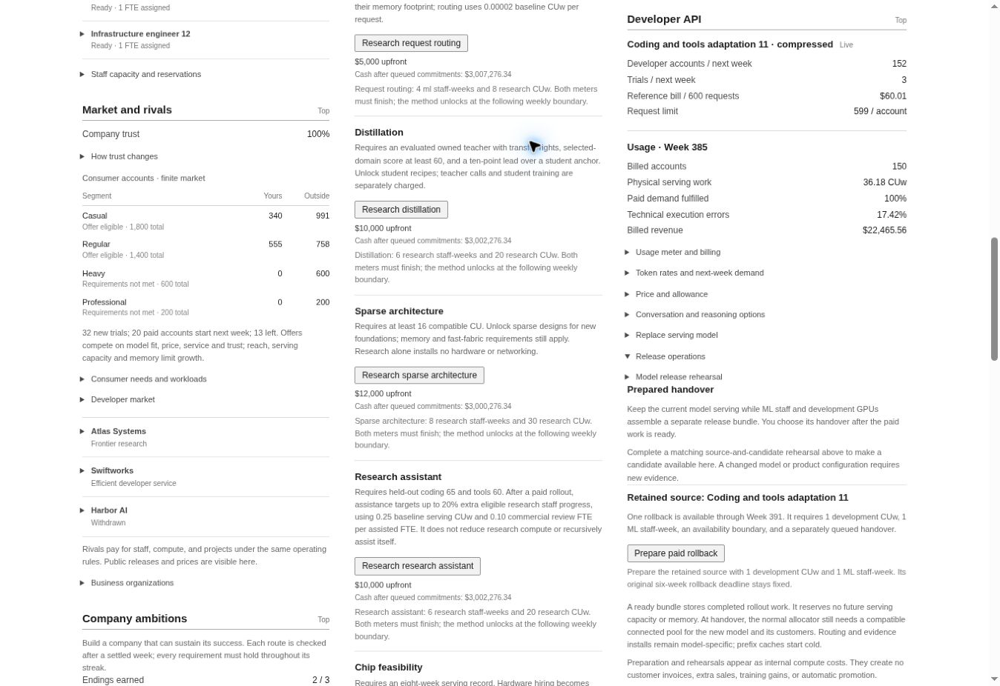

# Wave 9 release handoff

**Frontier Lab — Model release operations**

Content/build **0.10.0**; save schema **5**. This wave connects evaluated model candidates to existing public products through a paid comparison, a separately prepared release bundle, an explicit handover, and one paid rollback within a fixed retention window. Existing customers keep using the current deployment while development work proceeds.

The interface keeps the Universal Paperclips style. After Enterprise operations, each public product exposes a plain **Release operations** disclosure containing **Model release rehearsal**, **Prepared handover**, progress meters and saved history. Ordinary buttons and compact tables show prerequisites, work, memory, dates, costs and outcomes. All **28 authored research programs** remain available; this release applies the existing R12 discovery.

The earned integration campaign continues an authentic published Wave 8 company from **Week 371 to Week 389** with **nine ordinary commands**. It demonstrates a real efficiency/quality tradeoff, pays for both handovers, preserves the API contract and fractional billing carry, and round-trips the resulting save. [The complete progression receipt](evidence/wave9-progression.json) provides the figures used below.

## Unlocks, eligibility and work

**R12 — Enterprise operations** requires R3 and R10, an **$8,000 research fee**, **six infrastructure staff-weeks** and **12 research CUw**. Companies that have already earned R12 can use release operations when their product and models qualify. There is no additional research program or system rollout to install for this wave. These requirements come from [the research catalog](../src/content/catalog.ts).

A rehearsal needs an owned, deployed public product and a distinct candidate. Both models require their own matching, prior held-out capability reports and hosted commercial rights. The candidate must meet the existing release thresholds for that product. Each model also needs a compatible connected pool for its resident weights plus session workspace; sparse models retain their fabric requirement. Research, training, evaluation and commercial rights remain separate gates.

CU denotes compute capacity, CUw denotes work, and MU denotes resident memory. Normalized work is converted into physical GPU work by the actual hardware. Cloud reservation charges, owned physical-work tariffs and payroll continue through the ordinary company ledger.

| Operation | Work and staff | Timing | Resource commitment |
| --- | --- | --- | --- |
| **Model release rehearsal** | The source and candidate each execute **10,000 standard exchanges**; **one ML staff-week** reviews the pair | Both arms and review must finish; results become available at the next weekly boundary | Separate full model/session workspace for each arm while it runs |
| **Prepare a forward release** | **2 development CUw** and **2 ML staff-weeks** | At most **1 CUw and 1 ML staff-week per week**; completed work becomes available next boundary | Independent candidate workspace during GPU work |
| **Queue prepared handover** | Uses an already prepared, available bundle | The command commits next week; the switch occurs at the following boundary | The live model and customer workload use the ordinary serving allocator |
| **Prepare one rollback** | **1 development CUw** and **1 ML staff-week**, with the same weekly caps | Requires availability and a separately queued handover before the original deadline | Independent retained-source workspace during GPU work |

Each operation has **no additional upfront application fee**. The staff and GPU work are paid through ordinary wages and compute charges. Completed bundles store work already performed; they reserve **no ongoing future serving capacity or memory**. Staffing, allocations and connected memory can delay progress independently. The authored values are in [rehearsal rules](../src/content/wave9-rehearsals.ts) and [release rules](../src/content/wave9-releases.ts).

## 1. Compare the same finite workload

In a product’s **Release operations → Model release rehearsal**, choose an eligible candidate and select **Compare candidate model**. The two arms use the same **100 reserved benign cases**, each representing 100 standard exchanges. The case bank is fixed for the company and product kind. Renaming models, waiting or repeating a command cannot reroll it.

Both arms request ordinary development compute and their own resident workspace. They do not borrow adapter-bank memory sharing. A separate ML review request must also complete. Live serving keeps its established priority, while rehearsal work competes with the lab’s other development tasks. A pause retains completed work and stops further comparison and review progress.

The report exposes four finite counts: **useful answers, confident errors, false refusals, and clarification/uncertainty**. Here a false refusal means refusing an allowed task. The case bank does **not** test harmful-request policy or establish general model safety. Counts describe these reserved cases and cannot promise a live success rate.

The comparison uses the captured product features and the exact model versions. It **excludes routing, prefix caching, retrieval and evidence links**. These systems remain relevant to live product behavior and costs; their runtime gains are not included in the standard comparison. Stored installation identities help determine whether evidence still matches the current configuration.

A completed report qualifies a candidate only while the source deployment, relevant configuration, exact candidate and hosting eligibility still match. A later change can leave a valid historical report that no longer authorizes preparation. The workflow does not train either model, change its weights or capability scores, release the candidate, create customer usage, or issue a customer invoice. A lower useful-answer count does not automatically forbid a handover: the player weighs the measured tradeoff while normal eligibility gates continue to apply.

Physical GPU work is retained separately from normalized work. The displayed tariff estimate uses the execution hardware’s cloud reservation share or owned variable rate, and excludes payroll and shared site costs. The **Compute costs** meter, when installed, records settled whole-cent charges under **Development work** and reconciles them with the existing ledger. The report is not a second bill.

## 2. Prepare while the current product serves

Once matching evidence is available, choose **Prepare rehearsed release**. Preparation requires two development CUw and two ML staff-weeks, each capped at one per week. These meters can progress independently; both must finish before the bundle is ready, and its availability begins at the next weekly boundary.

The current product keeps its deployment while the bundle is assembled. Model, terms, features, retrieval and efficiency changes for that product are locked during pending preparation or a queued handover. Queue checks enforce the conflict in both command orders. Service itself can be paused or resumed, and the later handover preserves that explicit active or paused state.

An unfinished preparation can be paused. An unfinished or ready preparation can be discarded, retaining its spent resources and history while reopening product configuration changes. A scheduled handover is already committed and cannot be discarded through this control.

Choose **Queue prepared handover** only after the bundle is available. If the player selects it in Week **W**, the command commits in Week **W + 1** and schedules the model switch for Week **W + 2**. The existing model serves through the command boundary. At the cutover boundary, the model owner releases the candidate before product work is requested, and the product points to one replacement deployment.

The same product, accounts and billing contract continue. API token-bill remainder is retained. Normal subscription credits, token prices, workload allocation and invoice rules still govern service. A paid bundle does not guarantee sufficient capacity for all customers at cutover: the current compatible pool and full customer footprint must still support the workload. Eligibility and source consistency are checked again before the switch.

Routing and evidence installations remain tied to their model. Prefix caches start cold at handover. The player therefore needs to assess live demand and model-specific optimizations as well as the finite rehearsal result. The release workflow supplies preparation and evidence, while the existing product and resource systems determine subsequent service.

## 3. Retain one bounded rollback

A successful forward handover retains its source for **six weeks after the release week**. Within that window, **Prepare paid rollback** consumes one new development CUw and one new ML staff-week. The old paid source deployment proves what is being restored; it does not substitute for fresh rollback work.

Rollback follows the same availability and explicit handover boundaries. Admission requires enough remaining time for the minimum preparation sequence. The current deployment and captured configuration must still match, and the retained model must still be eligible to host. Resource starvation can use up the remaining window. Pausing, preparing or retrying does not move the original expiry date, and an expired pending rollback is discarded without a late switch.

The entitlement permits **one rollback preparation per release**. Discarding it also spends that one-use option. After a successful rollback, the source serves through a new deployment while product identity and billing continue. The forward release and both work histories remain saved.

## Saved proof and bounded history

The optional `releaseRehearsals` and `preparedReleases` maps appear only after adoption. Saves retain accepted command identities, exact model/report references, configuration fingerprints, real work grants, physical execution receipts, availability dates, promotion schedules and rollback deadlines. Validation checks these relationships before import or advancement.

History is bounded at **eight rehearsals per product**, **24 rehearsals globally**, and **eight prepared releases per product**. A new comparison can replace only stale completed rehearsals that are unreferenced. Rehearsals referenced by saved releases remain available as proof. Reaching a bound does not erase paid release history or confer another preparation automatically.

The [rehearsal validation](../src/core/wave9-rehearsals-validation.ts) checks finite outcomes, hardware conversions, work, memory, exact reports, chronology and retained cost frames. The [prepared-release validation](../src/core/wave9-releases-validation.ts) checks required effort, source identity, available evidence, explicit promotions, scheduled cutovers, one-use rollback and its original deadline. These checks protect simulation consistency; the save checksum is not an authentication or anti-cheat system.

## Ordinary campaign evidence

[The earned progression receipt](evidence/wave9-progression.json) starts from the authentic **Week 371** Wave 8 fixture, checksum **`d4ca620e`**, generated with published commit **`d55f5e167eb20ad635d2be3663f7fac5c96b1b64`**. Its established company already owns paid hardware, completed research and operating products. This continuation grants no money, staff, research, models, work or assets, and records no arrears.

The nine commands research compression, create a paid compressed variant, evaluate that exact candidate, set the API’s terms to exercise fractional billing, compare the models, prepare and promote the candidate, then prepare and promote one rollback. Other products, customer relationships, rivals and the already paid outbound rack relocation continue through ordinary weeks.

### Measured quality and execution tradeoff

The API uses extended context and deep reasoning, with memory disabled. Its rehearsal executes on the owned colocation training pool in **Week 379**, and the reviewed result becomes available in **Week 380**.

| Paired observation | Current source | Compressed candidate |
| --- | ---: | ---: |
| Reserved cases | **100** | **100** |
| Represented standard exchanges | **10,000** | **10,000** |
| Useful answers | **76** | **74** |
| Confident errors | **11** | **12** |
| False refusals of allowed tasks | **9** | **10** |
| Clarification/uncertainty | **4** | **4** |
| Normalized development work | **5 CUw** | **4 CUw** |
| Actual physical GPU work | **2.777777778 CUw** | **2.222222223 CUw** |
| Separate resident workspace | **2.33 MU** | **2.33 MU** |
| Settled assigned owned compute charge | **$208.33** | **$166.67** |

The candidate uses 20% less normalized work for the same standard workload and produces two fewer useful answers in this finite bank. Both arms receive real hardware grants; the assigned GPU charges total **$375.00**, with ML wages and shared infrastructure accounted for separately. This observation does not estimate a universal quality difference or guarantee the same savings for a routed, cached, retrieval-enabled or differently loaded product.

### Paid work and handover chronology

| Week | Recorded result |
| --- | --- |
| **371** | Import the earned company; queue compression research |
| **374–378** | Apply compression, evaluate the candidate and set API terms; current model remains live |
| **379** | Both rehearsal arms and the one-ML-staff-week review finish |
| **380** | Report becomes available; queue forward preparation |
| **381–382** | Pay **2 normalized CUw**, **1.111111112 physical CUw**, and **2 ML staff-weeks** for the bundle |
| **383** | Bundle is available; player queues its handover |
| **384** | Promotion command commits; source still serves |
| **385** | Candidate takes over; original rollback expiry is fixed at **Week 391** |
| **386** | Rollback consumes **1 normalized CUw**, **0.555555556 physical CUw**, and **1 ML staff-week** |
| **387–388** | Rollback becomes available; explicit promotion commits while the candidate still serves |
| **389** | Retained source takes over, within the original deadline |

Every observed API week from **379 through 389** has **100% fulfillment**, the same product and contract, and exactly **one weekly invoice**. These are outcomes of this sufficiently funded company, rather than a capacity promise from preparation itself. Customer counts and demand continue to change.

The actual token-bill carry is nonzero across both switches. At the Week 385 forward handover, the prior remainder **722,800** is carried into billing and becomes **212,800**. At the Week 389 rollback, **902,400** becomes **502,200**. These integers are the token-meter’s fractional billing numerator, not cents. No boundary resets them or duplicates an invoice. The original model’s canonical data remains unchanged.

| Campaign measure | Recorded result |
| --- | ---: |
| Ordinary continuation | **18 weeks**, Week **371 → 389** |
| Player commands | **9**, all admitted and committed |
| Starting and minimum cash | **$2,739,882.81** |
| Final cash | **$3,092,023.58** |
| Final weekly company revenue | **$38,636.43** |
| Final weekly operating expenses | **$19,038.92** |
| Final weekly operating surplus | **$19,597.51** |
| Final state checksum | **`4dff9002`** |
| Serialized snapshot size | **1,392,923 bytes**, below the **2 MB** limit |

These finances describe the whole operating company and its changing demand. They are not a controlled return-on-investment estimate for compression or release operations. The campaign verifies cost conservation in every observed week and an exact final save round trip.

Reproduce it with `npm test -- wave9-progression`. Setting `FRONTIER_WAVE9_OUTPUT` to a directory writes snapshots before rehearsal, after rehearsal, before promotion, after promotion and after rollback, plus `wave9-progression.json`. The tracked receipt linked above is an unchanged copy of the generated evidence.

## Save compatibility and the published Wave 8 oracle

Valid **Wave 0–8** snapshots migrate without advancing time. A Wave 8 import retains schema **5**, validates its original checksum and representation, and changes only content/build headers from **0.9.0 to 0.10.0**. Previously paid facility upgrades, rack moves, accounting reports, models, agents, contracts and random streams remain intact. Neither new optional map is initialized during migration.

Every older header rejects the new maps, including empty objects, and all seven new release commands, including pause commands with `paused: false`. Earlier feature guards still reject Wave 8 adoption records under a Wave 7 header.

Before the first upgraded browser write, the exact original Wave 8 bytes are archived under **`frontier-lab.wave8.original`** and offered as **Export original Wave 8 save**. Existing originals are retained. An archive failure blocks replacement of the primary save; a primary-write failure leaves the old primary and any successfully written archive recoverable. Earlier recovery copies retain their established behavior.

The durable [Wave 8 snapshot](../tests/fixtures/wave8-snapshot.json) and [twelve-week expected oracle](../tests/fixtures/wave8-expected.json) were generated with the exact published **`d55f5e167eb20ad635d2be3663f7fac5c96b1b64`** source, archived before Wave 9 production edits. Its natural Week 370 campaign first reproduced **`b70a084d`**. One ordinary **$1,500 outbound rack move** then produced the Week 371 fixture **`d4ca620e`**.

The old source archive and generation scripts were retained at `/workspace/scratch/4788498e7ff5/wave9-history/` during development. The committed fixture and expected-output files provide the lasting baseline, including source provenance, ordinary command receipts and twelve complete-state hashes. Expected outcomes were calculated by the archived Wave 8 engine, not by the new implementation.

For companies that do not adopt Wave 9, the new engine matches **all twelve full-state outcomes for Weeks 372–383**, after normalizing only content/build headers. This covers a paid rack remaining offline, its ready state at Week **375**, commissioning at **376**, the fixed infrastructure bill changing from **$660 to $780**, expiry of an unchanged historical cost report in Week **378**, and a customer-hosted license renewal in Week **383**. The final published hash is **`8353b885`**. Rack purchase and original installation evidence remain unchanged throughout.

## Focused verification

The focused migration, prior-engine oracle and browser-storage selection passes **87 distinct checks** across `wave1-migration` through `wave4-migration`, `wave5-compatibility` through `wave9-compatibility`, and `wave1-persistence`. This includes all seven new compatibility cases, exact twelve-week Wave 8 hashes, mid-relocation save/reload, corrupt checksum rejection, older-header guards, original-byte retention and archive/primary-write failures.

The release-specific suites are [wave9-rehearsals](../tests/wave9-rehearsals.test.ts), [wave9-releases](../tests/wave9-releases.test.ts), [wave9-progression](../tests/wave9-progression.test.ts) and [wave9-compatibility](../tests/wave9-compatibility.test.ts). Their checks cover normal paid grants and memory, starvation, pause and replay, finite case stability, stale configuration, owned execution costs, handover chronology, unchanged contract billing, one-use rollback, fixed expiry, bounded history and hostile save edits. The generated natural progression receipt records the earned Week 389 result above.

## Final release verification

**377 automated checks passed**, with zero failures and zero skips. `npm run typecheck` also passed. The official Sites production build completed successfully, with a non-blocking client bundle size advisory. [The validation receipt](evidence/wave9-validation.json) records the commands and outcomes.

Browser verification used the real interface to import the earned Week 378 company, select the compressed API candidate, pay for both comparison arms, prepare and explicitly schedule the forward handover, and fund and schedule its rollback. The UI showed the candidate live in Week 385 and the retained source restored in Week 389. Exporting before and after a reload produced **byte-identical 1,392,505-byte snapshots**, checksum **`b69b5bf0`**. Browser-generated command IDs differ from the scripted campaign, so their final checksums differ while the economic results agree. The original Week 0 preview save was restored after the check. [The browser receipt](evidence/wave9-browser.json) preserves the observed operation records and final usage.

Publication uses the existing private Site and the exact source commit packaged by the Sites workflow. Its saved-version provenance records the deployed commit.

## Current scope

Wave 9 provides finite model comparisons and explicit public-product release operations. It does not split live traffic into canary cohorts, replace the agent or training systems, add a harmful-request policy evaluation, or provide automatic capacity guarantees. The existing hiring, research, training, owned/cloud compute, physical infrastructure, consumer and business products, licensing, billing and rivalry systems continue to supply the strategic context.

All quantities, prices, model scores and outcomes are authored game parameters. Frontier Lab remains a deterministic browser simulation with local portable saves; there are no live model API calls, real GPU purchases, payment integrations or account-synchronized game saves in this release.
